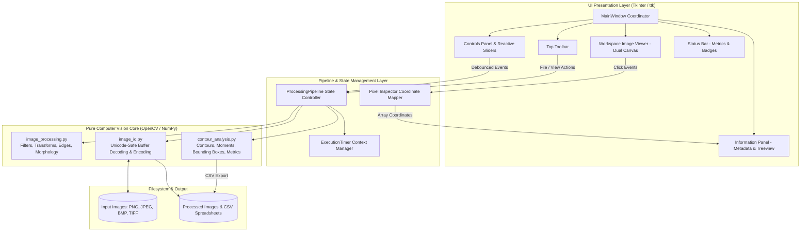
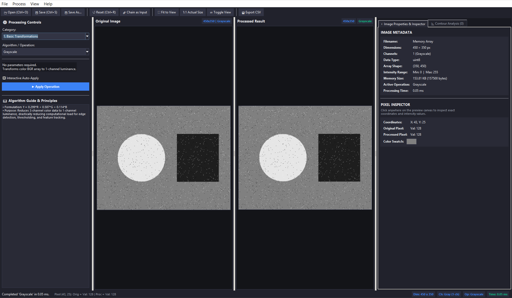
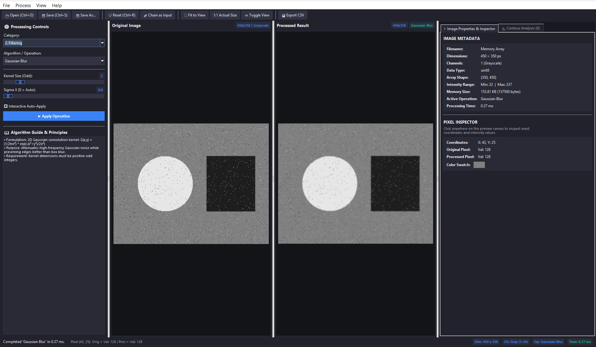
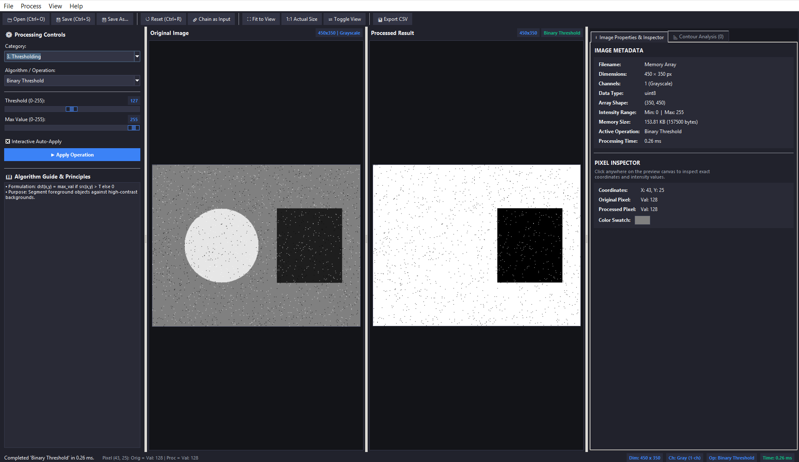
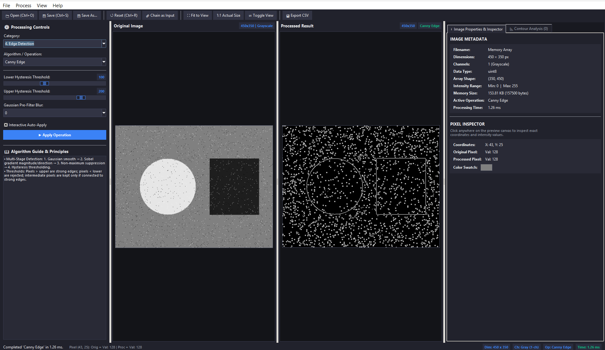
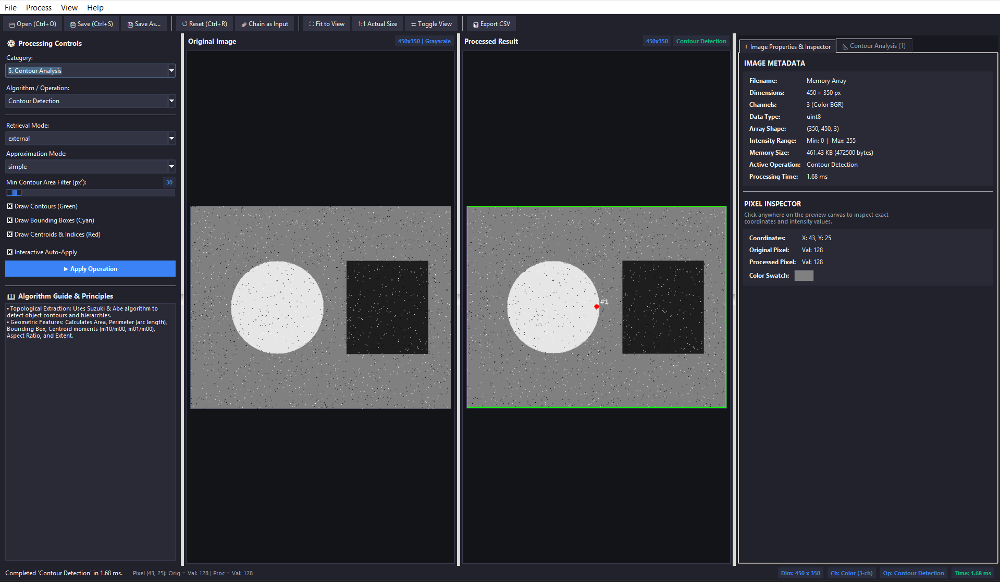
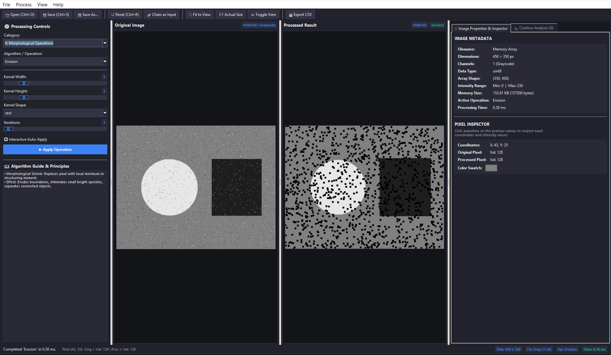

<div align="center">

# Image Processing Workbench

### *An Engineering-Grade Desktop Suite for Computer Vision & Robotics Perception*

[](https://www.python.org/)
[](https://opencv.org/)
[](https://numpy.org/)
[](https://python-pillow.org/)
[](https://docs.pytest.org/)
[](https://microsoft.com/windows)
[](#2-system-architecture--engineering-design)

<p align="center">
  <b>A modular, native desktop workbench for interactive experimentation, quantitative inspection, side-by-side comparison, and sub-millisecond performance profiling of classical computer vision algorithms.</b>
</p>

---

</div>

## Live Application Demonstration

<div align="center">
  <video src="Output_data/Screen_recorded.mp4" controls="controls" width="100%" style="border-radius: 10px; border: 1px solid #374151; box-shadow: 0 8px 24px rgba(0,0,0,0.5);">
    <source src="Output_data/Screen_recorded.mp4" type="video/mp4">
    Your browser does not support the video tag.
  </video>
</div>

---

## Table of Contents

- [1. Executive Overview](#1-executive-overview)
- [2. System Architecture & Engineering Design](#2-system-architecture--engineering-design)
- [3. Categorized Algorithm Deep Dive & Visual Gallery](#3-categorized-algorithm-deep-dive--visual-gallery)
  - [Category 1: Basic Transformations](#category-1-basic-transformations)
  - [Category 2: Filtering & Noise Suppression](#category-2-filtering--noise-suppression)
  - [Category 3: Global & Adaptive Thresholding](#category-3-global--adaptive-thresholding)
  - [Category 4: Canny Edge Detection](#category-4-canny-edge-detection)
  - [Category 5: Topological Contour Analysis](#category-5-topological-contour-analysis)
  - [Category 6: Mathematical Morphology](#category-6-mathematical-morphology)
- [4. Core Engineering Features](#4-core-engineering-features)
- [5. Project Directory Structure](#5-project-directory-structure)
- [6. Installation & Execution Guide](#6-installation--execution-guide)
- [7. Keyboard Shortcuts](#7-keyboard-shortcuts)
- [8. Test Suite & Verification Matrix](#8-test-suite--verification-matrix)

---

## 1. Executive Overview

In autonomous robotics, industrial inspection, and embedded perception, mastering fundamental computer vision algorithms before introducing heavy neural networks is critical. **Image Processing Workbench** provides a transparent, zero-black-box software laboratory where every mathematical operation can be observed, adjusted in real time, and measured with high precision.

### Key Capabilities
- **Dual-Canvas Comparison View**: Simultaneous display of pristine input and processed output with responsive aspect-ratio letterboxing.
- **Precision Pixel Inspector**: Click any point on preview canvases to map canvas pixel space back to exact NumPy array indices, displaying channel values (BGR, RGB, Hex) and live color swatches.
- **Hardware-Isolated Execution Timer**: Microsecond-resolution execution profiling (`time.perf_counter`) measuring algorithmic computation independently of Tkinter rendering and file I/O.
- **Non-Destructive State Management**: Original image arrays are strictly read-only; every operation executes idempotently from base inputs, with optional pipeline chaining.
- **Contour Feature Extraction**: Automatic Suzuki-Abe border following with instantaneous calculation of geometric properties (Area, Perimeter, Bounding Box, Moments Centroid, Aspect Ratio, Extent) and one-click CSV export.

---

## 2. System Architecture & Engineering Design

The application follows a strictly decoupled Model-View-Controller (MVC) architectural pattern, separating computational vision logic from the desktop graphical presentation layer.



### Architectural Highlights

1. **Non-Destructive Pipeline**: The loaded image is deeply copied upon arrival. The `original_image` array is immutable during interactive sessions. Any algorithm parameter tweak immediately dispatches against the pristine base array, preventing cumulative degradation.
2. **Event Debouncing**: Interactive sliders employ a 100 ms debounce timer (`after_cancel` / `after`), ensuring fluid parameter adjustments without frame stutter or event queue flooding.
3. **Letterbox-Aware Coordinate Mapping**: The canvas accurately translates click positions $(X_c, Y_c)$ through scale factors and symmetric letterbox offsets $(\Delta X, \Delta Y)$ to locate exact NumPy array indices $(X_{img}, Y_{img})$ regardless of window dimensions.
4. **Unicode Path Robustness**: Windows systems often fail when calling standard `cv2.imread()` on paths containing accents or non-ASCII characters. The workbench streams file bytes into a `numpy.uint8` buffer and decodes via `cv2.imdecode()`, ensuring 100% Unicode path compliance.

---

## 3. Categorized Algorithm Deep Dive & Visual Gallery

---

### Category 1: Basic Transformations

Spatial transformations and color-space reductions are standard preprocessing stages in sensor pipelines (e.g., camera mounting compensation, optical flow downsampling).

<div align="center">
  
</div>

- **Grayscale Conversion**: Uses standard ITU-R BT.601 perceptual luminance weights:
  $$\text{Luminance} = 0.299 \cdot R + 0.587 \cdot G + 0.114 \cdot B$$
- **Spatial Resizing**: Computes aspect-ratio bounded scaling factors ($\min(\frac{W_t}{W_o}, \frac{H_t}{H_o})$) and chooses `INTER_AREA` for downsampling or `INTER_LINEAR` for upsampling.
- **Geometric Flipping**: Inverts pixel matrices across horizontal axis ($code = 1$), vertical axis ($code = 0$), or dual axes ($code = -1$).
- **Orthogonal Rotations**: Exact 90°, 180°, and 270° clockwise rotations without interpolation blurring artifacts.

---

### Category 2: Filtering & Noise Suppression

Spatial convolution filters attenuate sensor noise and speckle prior to feature extraction.

<div align="center">
  
</div>

- **Gaussian Blur**: 2D isotropic convolution kernel providing smooth frequency attenuation:
  $$G(x, y) = \frac{1}{2\pi\sigma^2} \exp\left(-\frac{x^2 + y^2}{2\sigma^2}\right)$$
- **Median Blur**: Non-linear rank-order filter replacing each pixel with the statistical median of its neighborhood:
  $$\text{dst}(x, y) = \text{median}\left(\{\text{src}(x+i, y+j) \mid (i, j) \in K\}\right)$$
  *Robotics Note*: Demonstrates complete eradication of salt-and-pepper impulse noise where linear Gaussian filters merely smudge corrupt pixels.

---

### Category 3: Global & Adaptive Thresholding

Image binarization isolates foreground structures from background scene data.

<div align="center">
  
</div>

- **Binary & Binary Inverse**: Fixed global thresholding against user-selected cutoff $T$:
  $$\text{dst}(x,y) = \begin{cases} \text{max\_val} & \text{if } \text{src}(x,y) > T \\ 0 & \text{otherwise} \end{cases}$$
- **Otsu's Global Thresholding**: Iterates across gray-level histograms to determine the optimal threshold $T^*$ that minimizes intra-class variance:
  $$\sigma_w^2(t) = \omega_0(t)\sigma_0^2(t) + \omega_1(t)\sigma_1^2(t)$$
- **Adaptive Mean & Gaussian Thresholding**: Computes localized thresholds $T(x,y)$ across neighborhood blocks, subtracting constant $C$ to overcome illumination gradients and harsh shadows.

---

### Category 4: Canny Edge Detection

Canny's optimal edge detector extracts structural boundaries through a robust four-stage pipeline.

<div align="center">
  
</div>

1. **Gaussian Pre-filtering**: Attenuates high-frequency sensor noise.
2. **Sobel Gradient Operator**: Computes horizontal $G_x$ and vertical $G_y$ gradients, deriving magnitude $|G| = \sqrt{G_x^2 + G_y^2}$ and direction $\theta = \arctan(G_y / G_x)$.
3. **Non-Maximum Suppression (NMS)**: Thins edge ridges by suppressing pixels not at the local gradient maximum.
4. **Hysteresis Thresholding**: Dual-threshold classification preserving strong edges ($> T_{\text{upper}}$) and keeping weak edges ($T_{\text{lower}} \le \text{pixel} \le T_{\text{upper}}$) only if connected to strong edges.

---

### Category 5: Topological Contour Analysis

Detects connected components and computes geometric feature vectors for downstream robotic grasping and shape classification.

<div align="center">
  
</div>

- **Suzuki & Abe Border Following**: Extracts hierarchical topological relationships (`RETR_EXTERNAL`, `RETR_LIST`, `RETR_TREE`).
- **Computed Geometric Features**:
  | Feature Metric | Mathematical Definition | Robotics Application |
  | :--- | :--- | :--- |
  | **Contour Area** | Green's Theorem: $A = \frac{1}{2} \oint (x\,dy - y\,dx)$ | Object sizing & noise rejection |
  | **Arc Perimeter** | Closed contour path length: $P = \oint ds$ | Compactness metric |
  | **Bounding Box** | Minimum upright envelope: $(x, y, w, h)$ | Region of Interest (ROI) extraction |
  | **Centroid** | Moments: $c_x = \frac{m_{10}}{m_{00}}, c_y = \frac{m_{01}}{m_{00}}$ | Robot gripper alignment |
  | **Aspect Ratio** | Ratio of width to height: $\frac{w}{h}$ | Orientation & part classification |
  | **Extent** | Object fill ratio: $\frac{\text{Area}}{w \times h}$ | Structural rectangularity score |
- **CSV Data Export**: Complete measurement tables export to standard CSV format with a single click.

---

### Category 6: Mathematical Morphology

Set-theoretic operations utilizing configurable structuring elements (kernels) to refine segmented binary masks.

<div align="center">
  
</div>

- **Erosion ($A \ominus B$)**: Replaces center pixel with local minimum; eliminates isolated bright speckles and detaches weak bridges.
- **Dilation ($A \oplus B$)**: Replaces center pixel with local maximum; fills internal voids and repairs broken contours.
- **Opening ($A \circ B = (A \ominus B) \oplus B$)**: Erosion followed by dilation; eliminates small foreground noise without altering overall object size.
- **Closing ($A \bullet B = (A \oplus B) \ominus B$)**: Dilation followed by erosion; bridges small fissures and seals dark holes.
- **Morphological Gradient**: $(A \oplus B) - (A \ominus B)$; extracts outer structural boundaries.
- **Top-Hat & Black-Hat**: Highlights elements smaller than the structuring element on non-uniform backgrounds.

---

## 4. Core Engineering Features

| Feature | Engineering Implementation | Benefit |
| :--- | :--- | :--- |
| **Interactive Pixel Inspector** | Canvas inverse projection mapping $(X_c, Y_c) \to (X_{arr}, Y_{arr})$ | Immediate pixel-level numerical feedback |
| **Microsecond Profiler** | `time.perf_counter()` context manager wrapped around algorithms | Hardware benchmarking isolated from rendering overhead |
| **Unicode Path Engine** | `cv2.imdecode` & `cv2.imencode` over binary byte buffers | Eliminates path encoding crashes on Windows |
| **Chained Processing** | Optional pipeline source promotion (`use_processed_as_source`) | Multi-stage algorithm pipelines (e.g. Blur $\to$ Edge $\to$ Morphology) |
| **Dark Neutral Theme** | Custom-engineered Tkinter `ttk.Style` with `clam` engine | High-contrast, glare-free laboratory dark environment |

---

## 5. Project Directory Structure

```
ImageProcessingWorkbench/
├── main.py                            # Desktop application entry point
├── requirements.txt                   # Dependency definitions
├── README.md                          # Engineering documentation
├── .gitignore                         # Git tracking rules
│
├── core/                              # Computational Vision Core
│   ├── __init__.py                    # Public API exports
│   ├── performance.py                 # ExecutionTimer context manager
│   ├── image_io.py                    # Unicode-safe image encoder/decoder & metadata
│   ├── image_processing.py            # Standalone, pure CV algorithms
│   ├── contour_analysis.py            # Contour metrics, visualizer & CSV export
│   └── processing_pipeline.py         # Pipeline coordinator & state manager
│
├── app/                               # Presentation Layer (Tkinter / ttk)
│   ├── __init__.py
│   ├── theme.py                       # Dark neutral engineering theme & palette
│   ├── application.py                 # High-DPI awareness & application lifecycle
│   ├── main_window.py                 # Window layout, shortcuts & event coordination
│   ├── toolbar.py                     # Top workflow action bar
│   ├── image_viewer.py                # Dual canvas with letterboxed aspect-ratio scaling
│   ├── controls_panel.py              # Reactive parameter controls & algorithm notes
│   ├── information_panel.py           # Metadata properties & contour Treeview
│   └── status_bar.py                  # Real-time metrics and status indicators
│
├── tests/                             # Automated Test Suite (pytest)
│   ├── test_image_io.py               # Decoding, encoding, unicode, and error handling
│   ├── test_image_processing.py       # Filters, transforms, thresholds, canny, immutability
│   ├── test_contours.py               # Shape metrics, moments, CSV generation
│   ├── test_morphology.py             # Morphology operations & kernel shapes
│   ├── test_pipeline.py               # State management, chaining, and reset
│   └── test_gui.py                    # Automated GUI lifecycle & event simulation
│
├── images/                            # Synthetic Test Assets
│   ├── geometric_shapes.png           # Multi-color shapes for contour analysis
│   ├── noisy_sample.png               # Impulse noise for filter evaluation
│   ├── uneven_lighting_doc.png        # Gradient shadow document for adaptive thresholding
│   └── rotary_encoder_pattern.png     # Radial pattern for Canny edge tuning
│
└── Output_data/                       # Demonstrations & Artifacts
    ├── Screen_recorded.mp4            # Live desktop session demonstration video
    └── Screen_shots/                  # Categorized workbench screenshots
        ├── Category_1_Basic_Transformations.png
        ├── Category_2_Filtering.png
        ├── Category_3_Thresholding.png
        ├── Category_4_Edge_Detection.png
        ├── Category_5_Contour_Analysis.png
        └── Category_6_Morphological_Operations.png
```

---

## 6. Installation & Execution Guide

### Prerequisites
- Python **3.11** or **3.12** installed on Windows 10 / 11.
- `pip` package manager.

### 1. Clone & Set Up Virtual Environment

```powershell
# Clone the repository
git clone https://github.com/ramanujaganesh26/Image-processing-workbench.git
cd Image-processing-workbench

# Create virtual environment
python -m venv venv

# Activate virtual environment
# In PowerShell:
.\venv\Scripts\Activate.ps1
# In Command Prompt:
.\venv\Scripts\activate.bat
```

### 2. Install Dependencies

```powershell
pip install -r requirements.txt
```

### 3. Launch the Application

```powershell
python main.py
```

### 4. Run Automated Test Suite

```powershell
python -m pytest -v
```

---

## 7. Keyboard Shortcuts

| Shortcut | Description |
| :--- | :--- |
| **Ctrl + O** | Open an image from filesystem (PNG, JPEG, BMP, TIFF) |
| **Ctrl + S** | Save processed image to `output/` directory |
| **Ctrl + Shift + S** | Save processed image with custom destination and format |
| **Ctrl + R** | Reset processed image back to pristine original input |
| **Ctrl + Q** | Cleanly terminate application |

---

## 8. Test Suite & Verification Matrix

The repository includes a comprehensive 26-test automated suite executed via `pytest`:

```
============================= test session starts =============================
platform win32 -- Python 3.12.10, pytest-9.1.1, pluggy-1.6.0
collected 26 items

tests/test_contours.py::test_contour_detection_synthetic_shapes PASSED   [  3%]
tests/test_contours.py::test_contour_visualization_drawing PASSED        [  7%]
tests/test_contours.py::test_export_contours_to_csv PASSED               [ 11%]
tests/test_gui.py::test_application_initialization PASSED                [ 15%]
tests/test_gui.py::test_gui_image_loading_and_operation_workflow PASSED [ 19%]
tests/test_image_io.py::test_save_and_load_color_image PASSED            [ 23%]
tests/test_image_io.py::test_save_and_load_grayscale_image PASSED        [ 26%]
tests/test_image_io.py::test_load_invalid_path PASSED                    [ 30%]
tests/test_image_io.py::test_load_unsupported_format PASSED              [ 34%]
tests/test_image_io.py::test_load_empty_file PASSED                      [ 38%]
tests/test_image_io.py::test_unicode_path_support PASSED                 [ 42%]
tests/test_image_io.py::test_get_image_metadata PASSED                   [ 46%]
tests/test_image_processing.py::test_grayscale_conversion PASSED         [ 50%]
tests/test_image_processing.py::test_gaussian_and_median_blur PASSED     [ 53%]
tests/test_image_processing.py::test_standard_thresholding PASSED        [ 57%]
tests/test_image_processing.py::test_otsu_thresholding PASSED            [ 61%]
tests/test_image_processing.py::test_adaptive_threshold_constraints PASSED [ 65%]
tests/test_image_processing.py::test_canny_edge_detection PASSED         [ 69%]
tests/test_image_processing.py::test_basic_transformations PASSED        [ 73%]
tests/test_image_processing.py::test_original_image_not_modified PASSED  [ 76%]
tests/test_morphology.py::test_erosion_and_dilation PASSED               [ 80%]
tests/test_morphology.py::test_opening_and_closing PASSED                [ 84%]
tests/test_morphology.py::test_morphology_kernel_shapes_and_ops PASSED   [ 88%]
tests/test_morphology.py::test_morphology_invalid_parameters PASSED      [ 92%]
tests/test_pipeline.py::test_pipeline_lifecycle PASSED                   [ 96%]
tests/test_pipeline.py::test_pipeline_chaining PASSED                    [100%]

============================= 26 passed in 1.94s ==============================
```

---

<div align="center">
  <sub>Built for computer vision students, researchers, and robotics software engineers.</sub>
</div>
